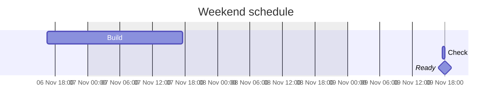
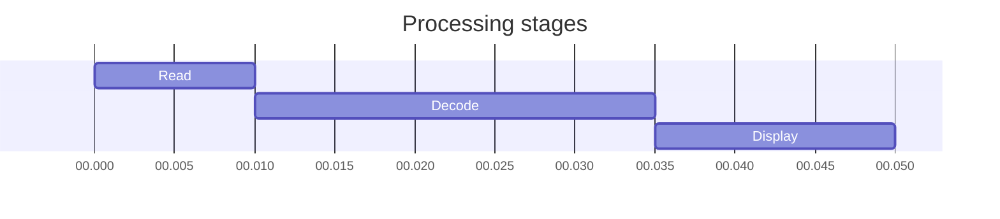
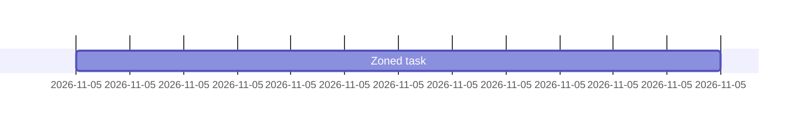

# Gantt schedules with times

## Hours and minutes

```mermaid
gantt
    title Morning release
    dateFormat HH:mm
    axisFormat %H:%M
    section Preparation
        Build  :done, build, 09:00, 1.5h
        Notes  :active, notes, 09:15, 10:00
    section Delivery
        Review :crit, after build notes, 30m
        Ship   :milestone, 0ms
```



## Across midnight

> ```mermaid
> gantt
>     title Overnight run
>     dateFormat HH:mm
>     Prepare :a, 23:30, 45m
>     Check   :after a, 30m
>     Finish  :milestone, 0ms
> ```

## Dated timestamps and calendar exclusions



## Millisecond intervals



## Source fallbacks

Timezone syntax and calendar-dependent clock-only schedules retain source:




