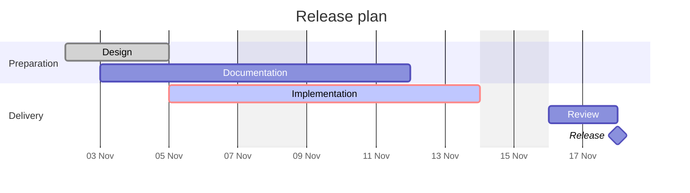
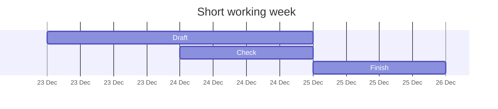
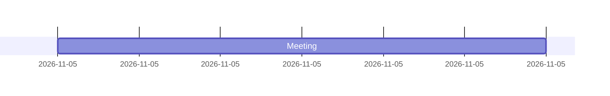
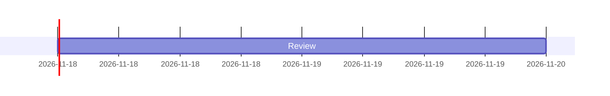

# Gantt charts

## Release plan



## Calendar dates and accented labels

> ```mermaid
> gantt
>     title Équipe — calendrier
>     axisFormat %d %b
>     section Préparation
>         Recherche :2024-02-27, 2024-03-01
>         Révision  :2d
>     section Livraison
>         Café      :crit, done, 2024-02-29, 1M
>         Prêt      :milestone, 0d
> ```

## Holidays and parallel work



## Source fallbacks

Unsupported timezone formats retain their complete source:



Unknown dependencies also retain source:


