# Mermaid diagrams

Flowcharts use native boxes, labels, and arrows:

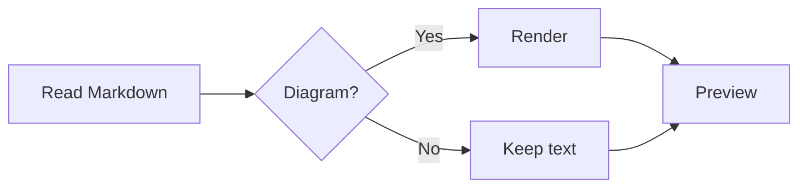

## Sequence

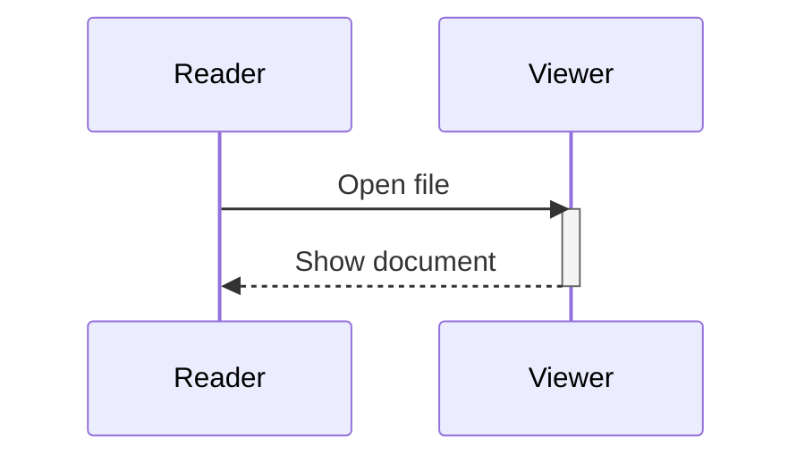

## Class

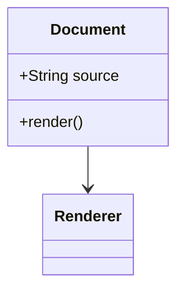

## State

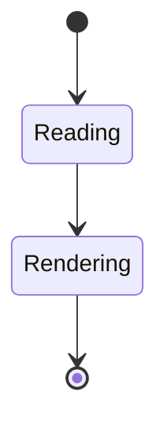

## Relationships

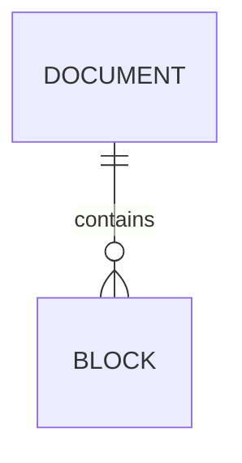

## Grouping

> ```mermaid
> flowchart TD
>     subgraph Input
>     A[Markdown] --> B[Parser]
>     end
>     subgraph Output
>     B --> C[Text]
>     B --> D[Images]
>     end
> ```

## Unicode labels

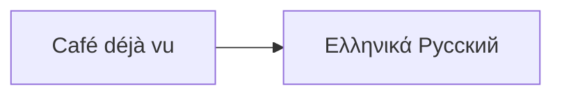

## Attribute tables

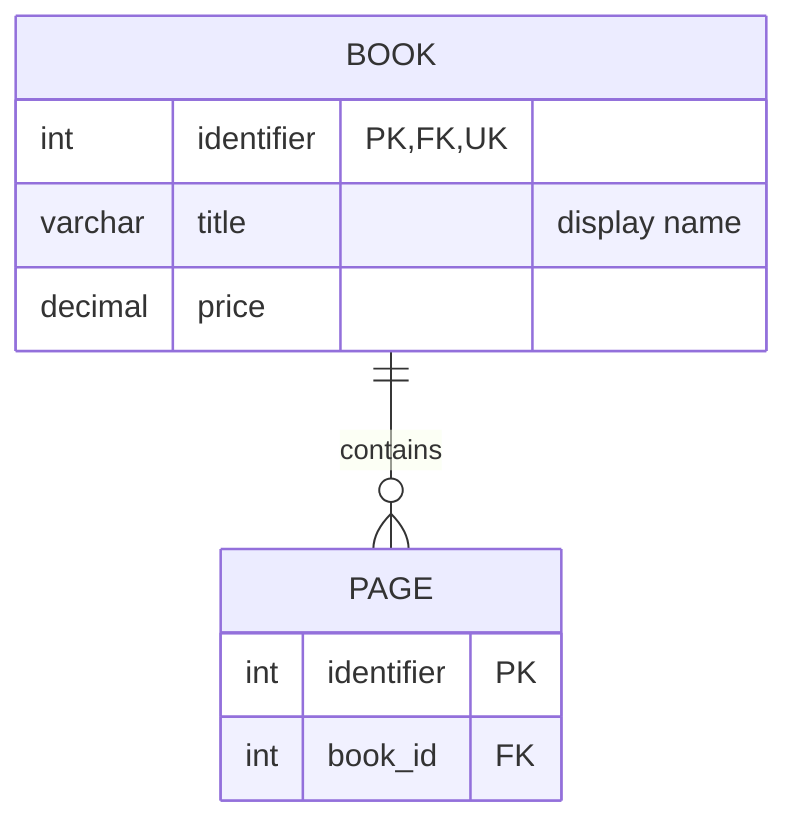

## Pie chart

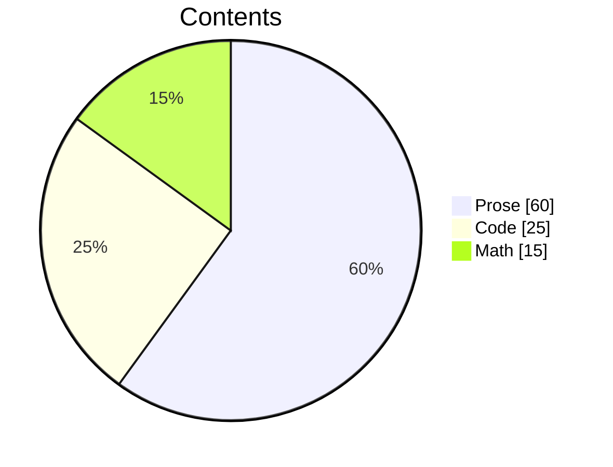

## Mind map

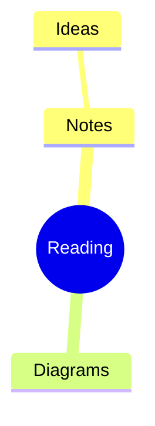

## Timeline

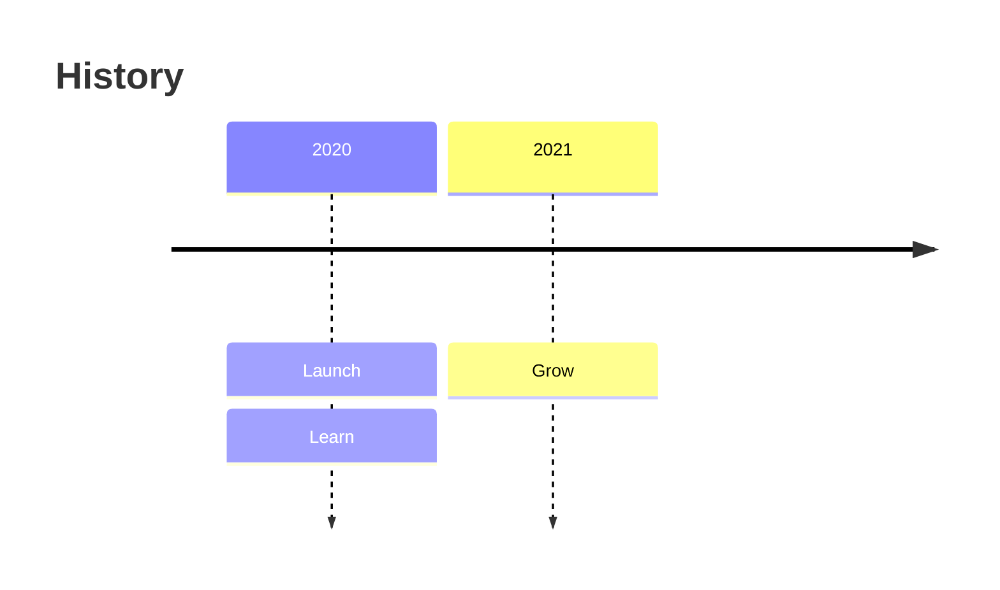

## User journey

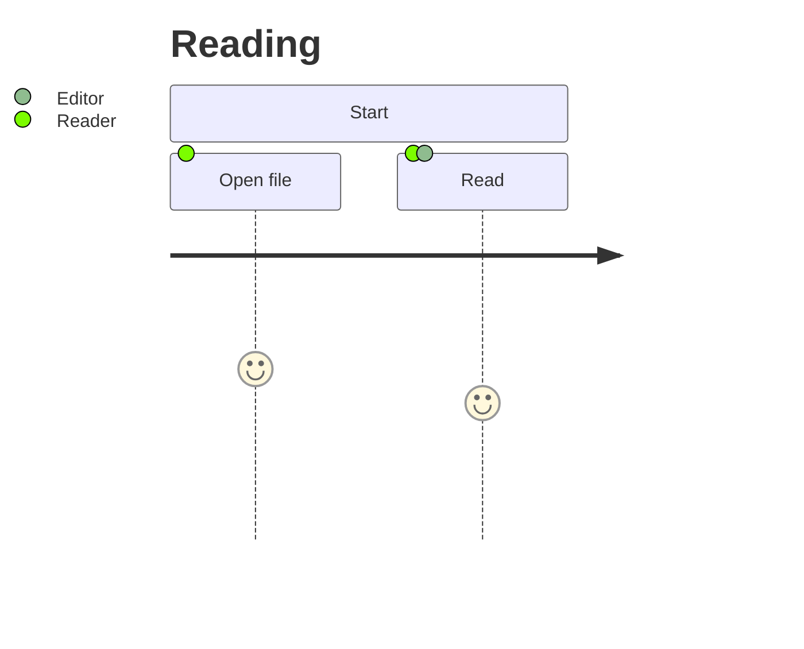

## Quadrants

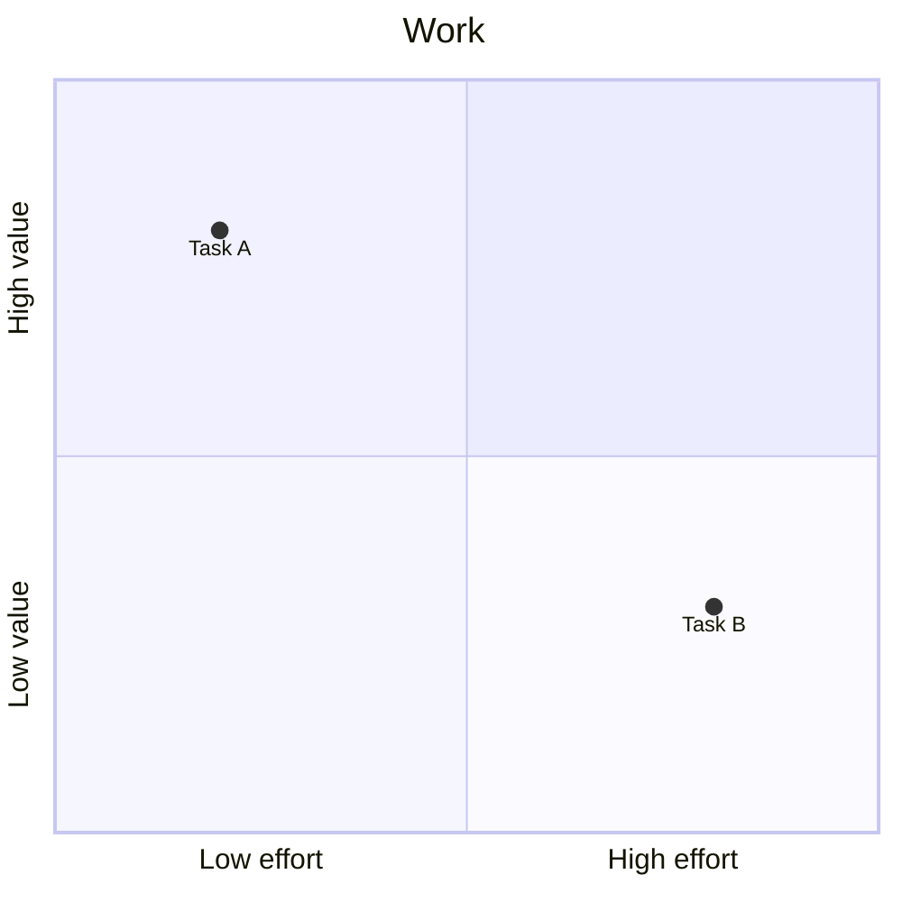

## Source fallback

Unsupported families and unavailable glyphs retain complete source:

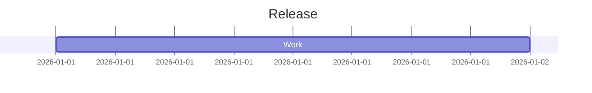

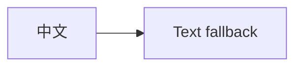
