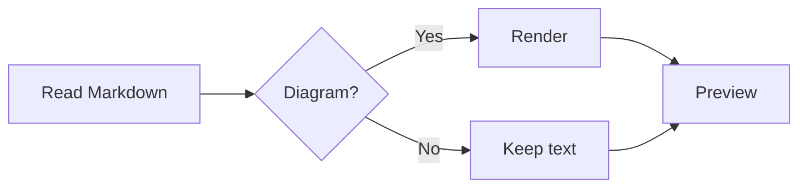
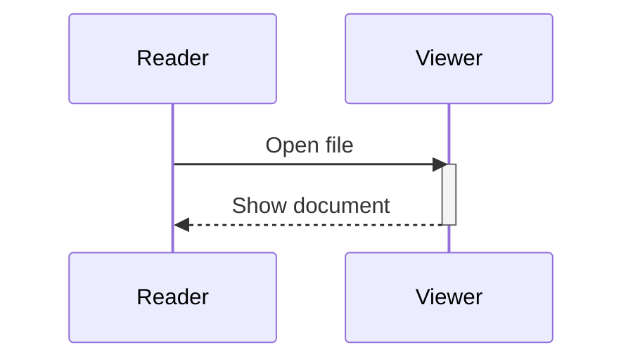
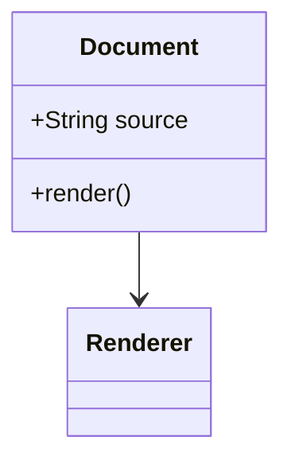
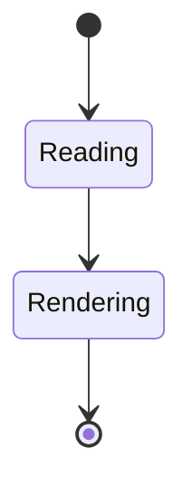
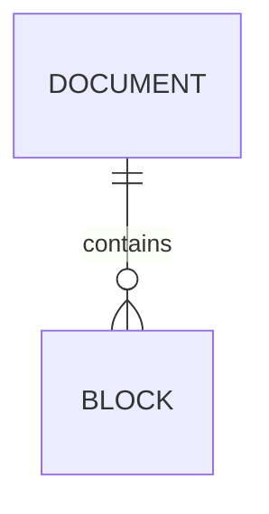
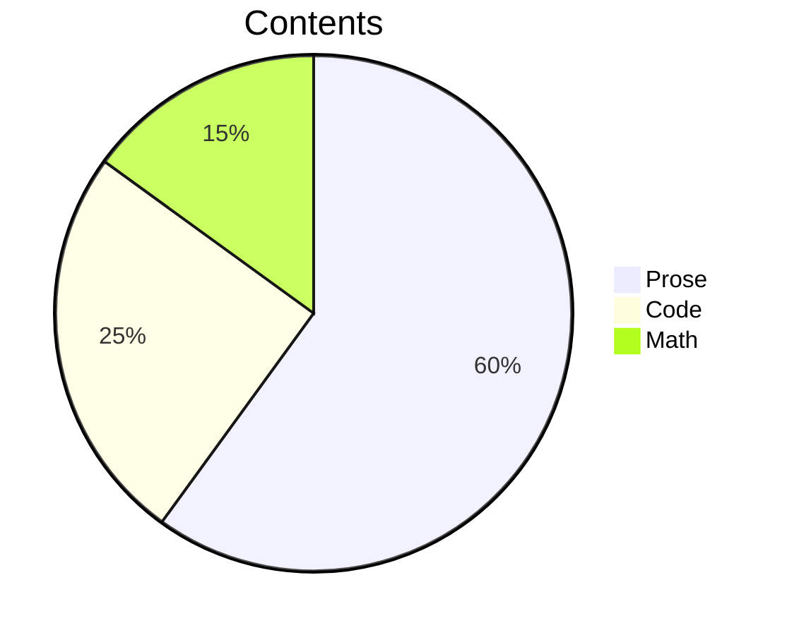
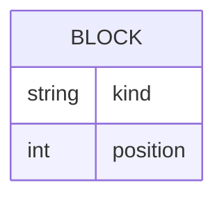

# Mermaid diagrams

Flowcharts use native boxes, labels, and arrows:



## Sequence



## Class



## State



## Relationships



## Grouping

> ```mermaid
> flowchart TD
>     subgraph Input
>     A[Markdown] --> B[Parser]
>     end
>     subgraph Output
>     B --> C[Text]
>     B --> D[Images]
>     end
> ```

## Source fallback

Diagram types outside the initial native subset retain their complete code:



ER attribute tables also retain their source in this version:



Use **Source** or **Preview** above a diagram to switch modes. **Copy** copies the original fence. Search for a label with `⌘F` to reveal its source.
